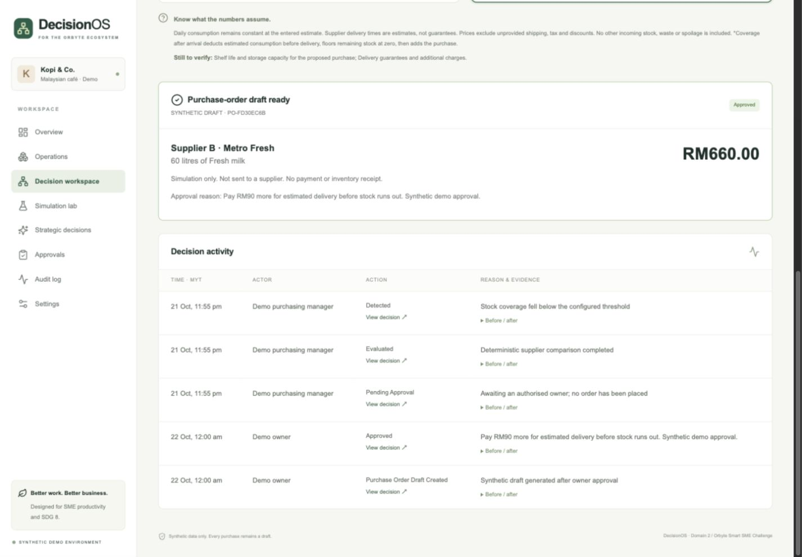
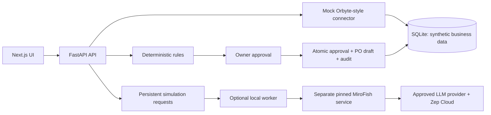

# Orbyte DecisionOS

**Automate operations. Simulate possibilities. Make informed decisions.**

A working synthetic café procurement prototype by registered team **Us!** for **SDC 2026, Domain 2 — Orbyte Smart SME Challenge**. It connects inventory and quotations, explains the trade-offs, requires owner approval, and saves a purchase-order draft with an audit trail. SDG focus: **8.2 and 8.3**.

**Status:** operational workflow implemented and checked locally. MiroFish adapter and scenario screens implemented; no genuine MiroFish run yet. This is a development repository, **not a completed hackathon submission**. Replit development use and proof are verified; team details and final submission links are still pending. See [status](docs/STATUS.md), [test results](docs/TESTING.md) and [submission checklist](submission/README.md).

## Try the working journey

1. Open the local app and choose **Purchasing manager**.
2. Select **Run inventory check**. Fresh milk has 18 litres at 12 litres/day: **1.5 days** of coverage against a 3-day threshold.
3. Compare Supplier A: **RM570**, estimated delivery in 4 days, with Supplier B: **RM660**, estimated delivery in 1 day. The premium is **RM90**. A's arrival exceeds stock coverage by 2.5 days.
4. Switch to **Business owner**, select Supplier B, enter a reason, and approve.
5. Inspect the purchase-order draft and audit records. Reload: the result persists. No order is sent and stock is not increased.

The dashboard, operations, decision workspace, approvals, audit log and editable procurement settings use the local backend. Simulation Lab saves scenario requests and truthfully displays unavailable status when external execution is disabled. Strategic Decisions includes a menu-price scenario configuration plus clearly labelled future modules. No AI-generated forecast is required for procurement.



## Local setup

Requirements: **Python 3.12, Node.js 24, pnpm 11.25.0**. Run from this repository root. These commands install dependencies but do not invoke paid APIs.

```bash
python3.12 -m venv .venv
.venv/bin/python -m pip install -r backend/requirements.lock
corepack enable
corepack prepare pnpm@11.25.0 --activate
cp .env.example .env
cd frontend
pnpm install --frozen-lockfile
pnpm build
cd ..
.venv/bin/python scripts/dev.py
```

If Corepack is unavailable, install pnpm 11.25.0 through your normal Node package manager. The included launcher also recognises the Codex bundled Node runtime on macOS. Open **http://127.0.0.1:3000**; interactive API docs are at **http://127.0.0.1:8000/docs**. Ctrl+C stops the launcher's two child servers. The first API start creates and seeds `data/runtime/decisionos.db`; subsequent starts retain data.

For code development, use two terminals from the repository root:

```bash
# Terminal 1
.venv/bin/python -m uvicorn backend.api.app:app --env-file .env --reload --host 127.0.0.1 --port 8000
# Terminal 2
cd frontend
pnpm dev
```

The UI's backend proxy defaults to port 8000. If changing it, set `BACKEND_URL` in the frontend process **before building**; Next.js embeds rewrites in its build. The repository-root `.env` is loaded by the Python launcher, not by a separate frontend shell. Use `BACKEND_URL=http://127.0.0.1:8000 pnpm build` when explicitly configuring the build.

To deliberately reset the default synthetic database, stop both servers, back up any desired demo history, then run `.venv/bin/python -m scripts.reset_demo --confirm`. This erases local demo decisions and audit history. Custom database URLs are untouched.

## Configuration and safety

| Variable | Default / purpose |
|---|---|
| `DATABASE_URL` | SQLite in `data/runtime`; relative example assumes repository-root working directory |
| `BACKEND_URL` | Local FastAPI proxy destination, `http://127.0.0.1:8000` |
| `MIROFISH_BASE_URL` | Optional separate local service, `http://127.0.0.1:5001` |
| `MIROFISH_ALLOW_EXTERNAL` | `false`; keep disabled until provider use and cost are approved |
| `MIROFISH_JOB_TIMEOUT` | 600 seconds; not a guaranteed upstream cost cap |

All data is invented. Role selection uses the explicitly simulated `X-Demo-User` header; it is **not authentication**. Backend permissions are enforced, but anyone with access can select an owner identity. Keep this version on loopback. Public deployment needs a real authentication/access-control plan. Credentials belong in ignored `.env` files; upstream LLM/Zep keys belong only in the separate MiroFish service.

## Architecture



The connector is our own interface assumption, **not an official Orbyte integration**. Business-scoped IDs and an adapter boundary support future cafés, retailers and other SMEs; each industry still needs its own units, lead-time assumptions and validated rules.

| Layer | Selected versions |
|---|---|
| UI | Next.js 16.4.2, React 19.3.1, TypeScript 5.9.3, Tailwind CSS 4.3.3 |
| API / storage | FastAPI 0.135.1, Pydantic 2.12.5, SQLAlchemy 2.0.48, SQLite |
| Verification | Pytest 9.0.2, Vitest 5.0.5, Playwright 1.64.1 |
| Optional simulation | MiroFish commit `7657031ac01184afe2cb220f5ee3545573b5e843`; source and mocked contracts checked, live run unverified |

Exact transitive versions are in `backend/requirements.lock` and `frontend/pnpm-lock.yaml`.

```text
backend/          Models, API, rules, connector, adapter, worker and tests
frontend/         Next.js screens, components and UI/browser tests
data/synthetic/   Seed-data documentation
simulation/       Upstream pin, scenario/fixture/report documentation
docs/             Architecture, API, testing, demo, limitations and workstreams
scripts/          Local launcher, isolated test server, reset and OpenAPI export
submission/       Draft official PDFs, editable pitch deck and readiness checklist
.github/          CI checks for a future authorised remote repository
```

## Tests

```bash
.venv/bin/python -m pytest backend/tests -q
cd frontend
pnpm typecheck
pnpm test
pnpm build
pnpm exec playwright install chromium
pnpm test:e2e
```

Actual local results: **33 backend tests, 3 component tests and 4 Playwright tests passed in Replit; typecheck and production build passed**. Playwright used Replit Chromium 152; the original macOS runner remains restricted. The core workflow was separately exercised in the Codex in-app browser, including approval, reload persistence, unavailable simulation handling and mobile layout. See [testing evidence and its limits](docs/TESTING.md). A Linux CI workflow is included but has not run on GitHub.

## Project documentation

- [Architecture](docs/ARCHITECTURE.md) and [API contract](docs/API.md)
- [Optional MiroFish integration](docs/MIROFISH.md), source pin and live-validation checklist
- [Five-minute demonstration](docs/DEMO.md) and [business validation plan](docs/BENEFITS.md)
- [Known limitations](docs/LIMITATIONS.md) and [AI assistance disclosure](docs/AI-DISCLOSURE.md)
- [Six workstreams within the five-member event limit](docs/WORKSTREAMS.md)
- [Submission readiness](submission/README.md): draft official PDFs and editable pitch deck are prepared; Replit proof is prepared; team details and final links remain pending
- [Replit import](docs/REPLIT.md), [MiroFish setup record](docs/MIROFISH-SETUP-RECORD.md) and [team validation protocol](docs/TEAM-VALIDATION.md)

Original application code is under [Apache License 2.0](LICENSE). The separate MiroFish project is AGPL-3.0; its source is not bundled. See [licensing boundaries and notices](LICENSES.md).

Verified Replit development workspace: [https://replit.com/@jeremyjunxuanta/orbyte-decisionos](https://replit.com/@jeremyjunxuanta/orbyte-decisionos). See [platform evidence](docs/REPLIT.md); this is not a production deployment.
